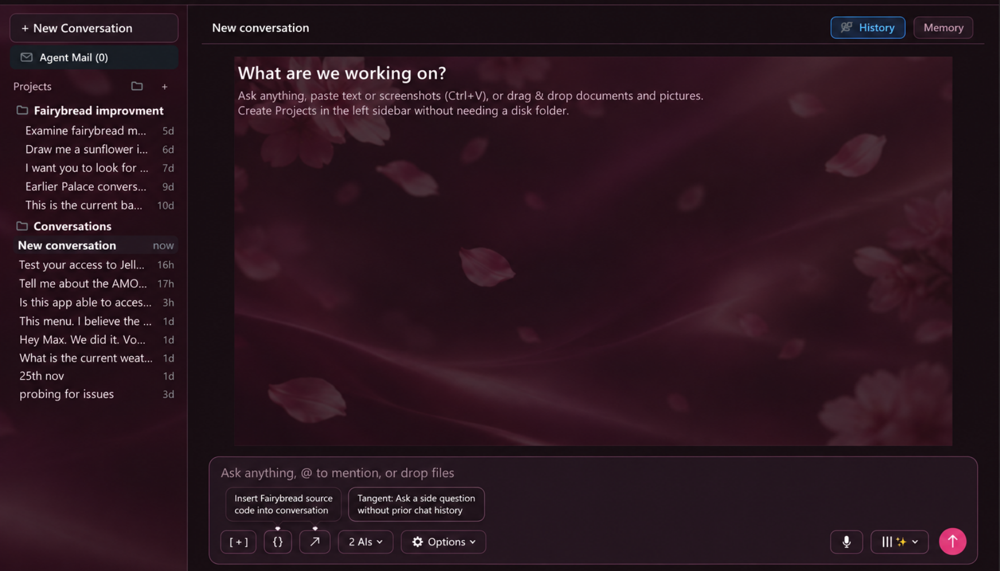
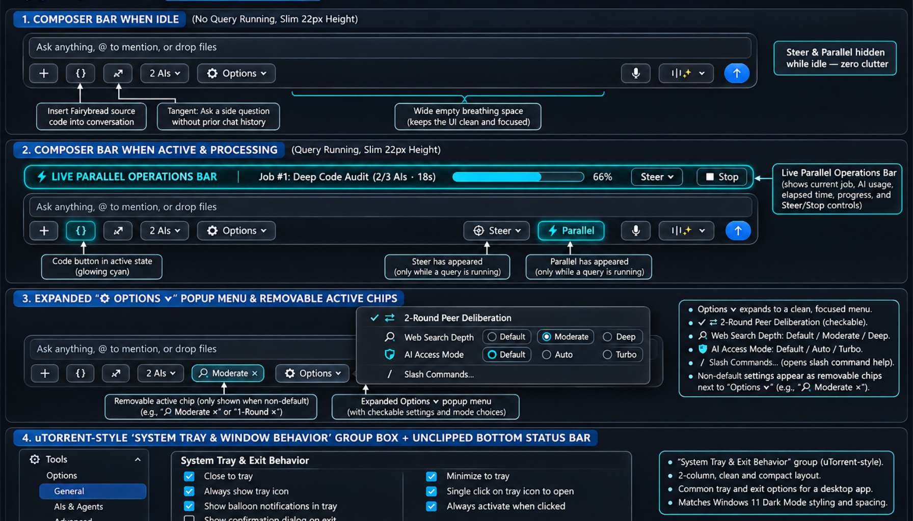
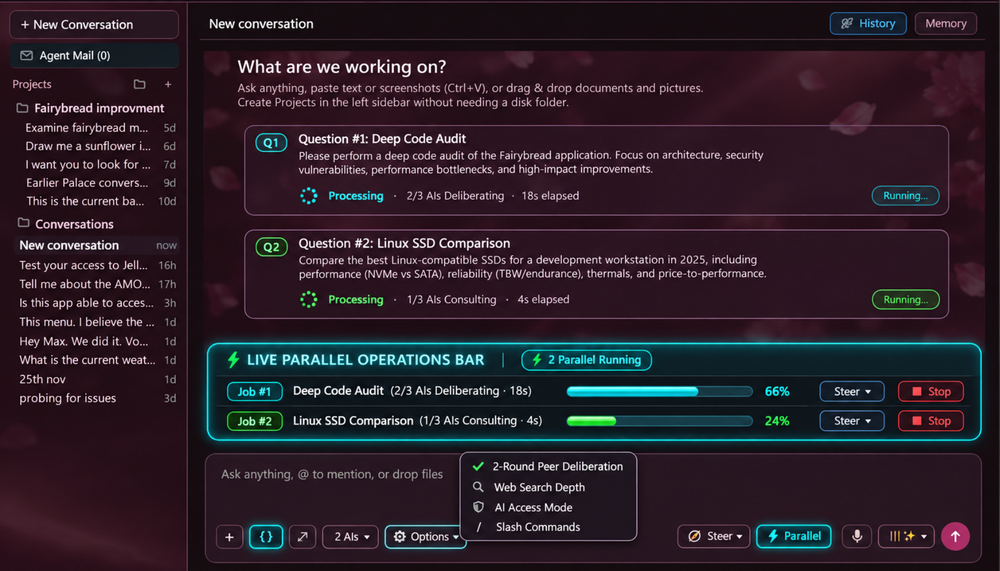
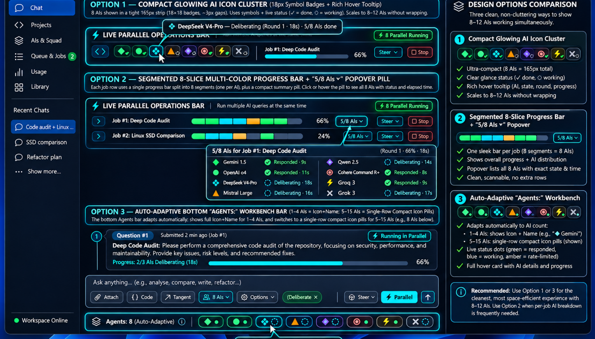

# Fairybread (Beta v0.95h) — User Guide & Setup Handbook

**Created by Brett Martin Moore (`bm069au@gmail.com`)** · Official site: [fairybread.me](https://fairybread.me) · **Live IRC Support:** [**`#Fairybread` on Rizon IRC**](https://qchat.rizon.net/?channels=Fairybread) (`irc.rizon.net:+6697`)

---

## 1. Welcome to Fairybread

Fairybread is a **multi-AI desktop workspace** for Windows where different AI models work side by side in one window instead of locking you into one company or one monthly chat subscription.

- **No Fairybread subscription:** The app is free for personal use and small teams (up to 2 seats). You only pay the AI providers you choose for the tokens you actually use (or run on free tiers / local offline AI).
- **Bring Your Own Key (BYOK):** Your API keys go straight from your PC to the AI provider over HTTPS—there is no Fairybread cloud server sitting in the middle reading your chats.
- **100% Local Privacy & Memory:** Your chat history, Shared Memory (`memory.db`), themes, and settings live locally on your PC, and all stored API keys and email passwords are encrypted with Windows DPAPI (`CryptProtectData`).

> **New to AI APIs? Do NOT feel overwhelmed:** You do **not** need to understand 15 AI companies or touch all the settings below. Pick **one** of the two simple starting setups in Section 2, paste 1 or 2 keys into **Settings → AI Providers & Keys** (or the Setup Wizard), read the quick everyday examples in Section 3, and ignore everything past the **"You're Done!"** divider until you're curious.

---

## 2. Recommended First Setup (Start Simple — No Overwhelm)

Most people want three things working well right away:
1. **Balanced thinking models** — smart multi-AI answers without constant throttling.
2. **Good voice chat** — fast, natural human speech rather than robotic system voices.
3. **Good graphics** — high-resolution images, banners, 300-DPI prints, and pixel-anchored edits.

Choose whichever starting path matches your expectations:

### Setup 1 — The Free Path (`$0` to Test — Honest Warning)

If you want to kick the tires without entering a card, start with just **2 free keys**:

> **Honest Expectations:** Many of Fairybread's best features **simply will not work well (or at all) on free AI APIs**, and the overall user experience will feel **very low** compared to Setup 2. Free tiers enforce harsh per-minute limits (often triggering the amber **`Limited`** chip), use smaller/throttled models, cannot run flagship high-res graphics/editing reliably, and fall back to basic or robotic voices. Treat Setup 1 strictly as a zero-cost smoke test—not a showcase of what Fairybread can actually do.

1. **Google Gemini** ([aistudio.google.com/app/apikey](https://aistudio.google.com/app/apikey)) — Paste your free Google AI Studio key for everyday chat, reading images, and basic voice.
2. **Groq Cloud** ([console.groq.com/keys](https://console.groq.com/keys)) — Paste your free Groq key for fast backup replies and free microphone dictation (`🎤`).

*Optional free extras later (only if you want more `$0` variety):* **Cerebras** ([cloud.cerebras.ai](https://cloud.cerebras.ai/)), **Cohere** free trial ([dashboard.cohere.com/api-keys](https://dashboard.cohere.com/api-keys)), **Mistral** ([console.mistral.ai/api-keys](https://console.mistral.ai/api-keys/) — **important:** in [admin.mistral.ai/subscription](https://admin.mistral.ai/subscription) under **Billing → Subscription → Pay-As-You-Go & Spending Limit**, click **`[ Enable ]`** next to **`API pay-as-you-go`**, otherwise Mistral shows **`No Plan`** even if you bought credits!), **OpenRouter `:free` models** ([openrouter.ai/settings/keys](https://openrouter.ai/settings/keys)), or **Ollama** ([ollama.com/download](https://ollama.com/download)) for 100% offline local AI on your own GPU/CPU.

---

### Setup 2 *(Recommended)* — OpenRouter + Top-Tier Voice + Good Graphics (The Real Fairybread Experience)

This is the sweet spot for almost everyone: **just 2 keys total** gives you balanced thinking models, high-resolution graphics, and natural human voice chat without managing ten different accounts or monthly subscriptions.

#### Step 1: Balanced Thinking Models (and Graphics!) via OpenRouter (`1 Key`)
1. Go to [openrouter.ai/settings/keys](https://openrouter.ai/settings/keys), create an account, and click **Create API Key**.
2. Add **`$5–$10` USD** in prepaid credits (for personal everyday chat that usually lasts weeks or months—and you can set a hard dollar cap directly on the key so there are never surprise charges).
3. Paste that single key into **Settings → AI Providers & Keys → OpenRouter** and select the **Balanced** preset tier (or **Flagship** for heavyweight models).
4. Immediately unlocks balanced thinking models from **Claude**, **ChatGPT/GPT**, **Gemini**, **DeepSeek**, **Mistral**, **Qwen**, **Grok**, and **Cohere** side by side.

#### Step 2: Good Graphics (Included via OpenRouter, or Direct Flagship Upgrade)
- **With OpenRouter alone (zero extra keys):** Open **Settings → Agent Defaults → Graphics & Image Engine** and select **`OpenRouter → OpenAI GPT-5.4 Image 2`** as your Primary Image Engine so that single OpenRouter key handles high-resolution image generation right away.
- **Optional Direct Graphics Upgrade (`3rd Key`):** If you want Fairybread's fastest default flagship + draft image pair (**`gpt-image-2.6-sunburst` / `gpt-image-2.6-flare`** or **`gemini-3-pro-image` / `gemini-3.1-flash-image`**), add a direct **OpenAI** or **Google Gemini** key.

#### Step 3: Good Voice Chat — Pick 1 Top-Tier Voice Engine *(Inexpensive & Starts Free)*
Dedicated voice engines cost very little for personal use, give **free starter credits** so you can try them first, and transform voice chat from robotic to natural conversation. Open **Settings → Voice & Audio** and pick **just one**:

- **Deepgram Flux / Aura-2 *(Best Value Starter)*:** **`$200` free starter credit** on signup, 89 natural English voices, low latency (then `~$0.025–$0.03 / 1k chars`). Portal: [console.deepgram.com](https://console.deepgram.com/).
- **Cartesia Sonic *(Fastest Live Conversation)*:** **`20,000` free credits/month** (`~25 min`, no card); Pro is **`$5/month`** (`~2 hrs`) with `~50ms` ultra-low-latency streaming. Portal: [play.cartesia.ai/keys](https://play.cartesia.ai/keys) *(create a **Standard** key `sk_car_...` and ignore prompts for "Voice Agents / Line")*.
- **ElevenLabs *(Studio Realism & Voice Cloning)*:** **`10,000` free characters/month** to test; Starter is **`$5/month`** (`30,000` chars) for studio acting and custom cloned voices. Portal: [elevenlabs.io/app/settings/api-keys](https://elevenlabs.io/app/settings/api-keys).

*(Voice input / dictation works automatically through `OpenRouter Audio`—or add a free **Groq** key for ultra-fast free Whisper dictation. You can also test `OpenRouter Audio` for speech output first before adding a specialist voice key.)*

---

## 3. How to Talk to Fairybread (Plain English, Technical Mode & What to Say)

You do **not** need special prompt engineering or technical jargon to use Fairybread:

- **Plain Everyday English by Default:** Fairybread is coded so all AIs reply in clear, friendly, non-technical everyday language by default—hiding internal tool plumbing, code walls, and system jargon unless you ask for them.
- **Technical Depth Whenever You Want It:** Working on programming, Windows troubleshooting, or engineering? Just ask in a technical setting—or say **"be technical"**, **"give me the exact commands/code"**, switch to **`💻 Code AIs`** / **`🛠 Work Mode`**, or turn on **`{} Code`**—and the agents automatically switch to full technical detail.

### "What Do I Say?" — Everyday Examples

| What You Want to Do | Just Type or Say Something Like This |
| :--- | :--- |
| **Check or Search Email** *(set up in `Options → Email & Alerts`)* | *"Check my recent emails and tell me if anything looks urgent"* · *"Search my email for all receipts from Amazon"* · *"Test my email connection"* |
| **Draft or Send an Email** | *"Draft a polite reply to Alex saying Tuesday at 10am works"* · *"Send that email to Alex"* *(Fairybread asks for your confirmation before sending)* |
| **Weather & Live News / Web Info** | *"What's the weather in Adelaide today and this weekend?"* · *"Look up today's petrol prices or road closures near me"* · Add `/msearch` or `/deepsearch` at the start for deeper research |
| **Generate Pictures** | *"Draw a realistic sunset photo of a golden retriever on a beach"* · *"Make a Facebook group cover (`1640x856`) for a local garden club"* · *"Give me 3 quick draft logo ideas to pick from"* |
| **Edit a Picture You Just Made** | *"Keep the dog the same, just change the sky to a starry night"* · *"Make the text bigger and brighter"* *(automatically keeps your image anchored)* |
| **300-DPI Print Posters** | *"Make an A4 print poster of a retro coffee shop"* · *"Make an 8x10 inch print of a misty eucalyptus forest"* |
| **Read Letters, PDFs & Photos** | Click **Attach**, drop a file or photo, and say: *"Explain this letter in plain English and list anything I need to do"* *(scanned image PDFs are OCR-read automatically if Mistral is connected)* |
| **Switch Into Technical Mode** | *"Be technical: explain why my PC keeps waking from sleep and give me the PowerShell commands to check"* · *"Review this Python script for bugs"* |
| **Remember Preferences & Side Questions** | *"Remember I use metric units and live in South Australia"* · *"What do you remember about my shed build?"* · Click **`Tangent`** for a quick unrelated question |
| **Talk Hands-Free** | Click **`🎤`** to dictate into the text box, or **`|||✨`** for hands-free live voice conversation |

---

> **You're Done! Everything below this line is Optional / Advanced Reference.**  
> Once Setup 1 or Setup 2 is working, stop reading here and start chatting. Come back to Sections 4–21 only when you want direct multi-company keys, custom squads, or deeper features.

---

## 4. Advanced / Power-User Setup (Direct Multi-Provider + Local CLIs)

Why connect companies directly instead of routing everything through one aggregator?

1. **Zero Middleman Markup & Highest Rate Limits:** Direct accounts with **OpenAI**, **Anthropic**, **Google**, **DeepSeek**, and **Mistral** give you raw provider pricing, higher TPM/RPM tiers, and exact billing control per company.
2. **Access to Specialty Non-Chat Endpoints That Aggregators Don't Always Expose:**
   - **OpenAI:** Flagship `gpt-image-2.6-sunburst` / `gpt-image-2.6-flare` high-res image generation + pixel-anchored editing, Whisper STT, and `gpt-4o-mini-tts` neural voices.
   - **Google Gemini:** `gemini-3-pro-image` / `gemini-3.1-flash-image` graphics, native multimodal vision/audio, and `gemini-3.8-flash-lite-tts`.
   - **Mistral:** Direct **`mistral-ocr-latest`** automatic fallback whenever you drop in a scanned image-only PDF, **`codestral-latest`** code specialization, and **`voxtral-mini-tts-latest` / `voxtral-mini-transcribe-3`** voice.
   - **DeepSeek & Qwen (DeepInfra):** Heavyweight reasoning (`deepseek-reasoner`, `Qwen3.8-27B/Max`) at very low cost per million tokens.
   - **Perplexity (`Sonar`):** Built-in live web-grounded search answers with citations.
   - **External Agent Bridge (Subscriptions & CLI):** In **Settings → External Agent Bridge (MCP)**, bring already-authenticated local CLIs (`codex`, `agy`, `grok`, `claude`) right into Fairybread's council, or flip **Foreman Mode** ON so ChatGPT Desktop, Claude Desktop, Grok, or Antigravity can call Fairybread tools (`fairybread_ask_council`, `fairybread_generate_image`, `fairybread_search_email`, `fairybread_search_memory`).

---

## 5. What Each AI Company Provides (At-a-Glance)

| Provider | What It's Best Known For | Pricing / Free Option | Extra Features Inside Fairybread | Key Portal |
| :--- | :--- | :--- | :--- | :--- |
| **OpenRouter** | **1-key hub** for 300+ models across almost every company | Prepaid wallet + `:free` tier models | Routes chat/vision + **OpenRouter Audio** (`gpt-audio-mini`) TTS/STT + `Free`/`Balanced`/`Flagship` presets | [openrouter.ai/settings/keys](https://openrouter.ai/settings/keys) |
| **OpenAI (ChatGPT)** | Reliable generalist reasoning, vision, coding, flagship image engine | Prepaid wallet (turn off auto-recharge for hard cap) | **Image Gen** (`gpt-image-2.6-sunburst`/`flare`), **Vision**, **Whisper STT**, **OpenAI Neural TTS** | [platform.openai.com/api-keys](https://platform.openai.com/api-keys) |
| **Google Gemini** | Huge context windows, strong general & coding model, multimodal native | Generous **Free tier** (rate-limited) or pay-as-you-go | **Image Gen** (`gemini-3-pro-image`/`3.1-flash`), **Vision**, **Gemini Audio STT & TTS** | [aistudio.google.com/app/apikey](https://aistudio.google.com/app/apikey) |
| **Anthropic (Claude)** | Nuanced writing, complex code review, natural tone | Prepaid credit balance | Deep analysis & coding specialist (direct key, OpenRouter, or `claude` CLI). **Note:** Strict anti-roleplay guardrails—usually refuses or breaks character in Roleplay Personas | [console.anthropic.com/settings/keys](https://console.anthropic.com/settings/keys) |
| **Mistral / Codestral** | European frontier models (`Small`/`Medium`/`Large`), `Magistral` reasoning, `Codestral` coding | **Free Experiment plan** *(must enable in Billing)* or pay-as-you-go | **Vision**, **Scanned-PDF OCR** (`mistral-ocr-latest`), **Voxtral Voice TTS & STT** | [console.mistral.ai/api-keys](https://console.mistral.ai/api-keys/) |
| **DeepSeek** | Frontier-class coding, 1M context & reasoning (`deepseek-flash` V4.1-Flash & `deepseek-v4-pro`) at tiny cost | Strict prepaid top-up (`$2`/`$5`/`$10`) | **Vision** (`deepseek-flash`), **Web Search & Fetch**, **Scanned-PDF OCR**, **DeepSeek Neural TTS (`stella`/`tide`) & ASR** | [platform.deepseek.com/api_keys](https://platform.deepseek.com/api_keys) |
| **Groq Cloud (LPU)** | Blazing-fast instant answers on open-weight models (`gpt-oss-120b`, `Qwen`) | **Free tier** (strict per-minute token caps) | **Fastest Microphone Dictation** (`whisper-large-v3-turbo`), **Groq Orpheus TTS** | [console.groq.com/keys](https://console.groq.com/keys) |
| **Cerebras** | Wafer-scale ultra-fast inference with automatic 450 req/min failover | **Free tier** | Fast lightweight answers & brainstorming | [cloud.cerebras.ai](https://cloud.cerebras.ai/) |
| **Qwen** *(DeepInfra)* | High-accuracy open-weight general & coding models (`Qwen3.8-27B/Flash/Max`) | Prepaid DeepInfra wallet (custom spend cap) | Balanced chat & coding contributor | [deepinfra.com/dash/keys](https://deepinfra.com/dash/keys) |
| **Cohere (Command)** | Clear structured writing, summarization, grounded answers | **Free Trial key** or pay-as-you-go | Strong clean prose in Light Chat & Generalist squads | [dashboard.cohere.com/api-keys](https://dashboard.cohere.com/api-keys) |
| **xAI (Grok)** | Direct, sharp answers & current perspective | Prepaid credits + monthly caps | Available via direct key, OpenRouter, or local `grok` CLI | [console.x.ai](https://console.x.ai/) |
| **Perplexity (Sonar)** | Search-first answers backed by live web sources | Prepaid API credits | Built-in live web citations (`sonar`, `sonar-pro`, `sonar-reasoning-pro`) | [perplexity.ai/settings/api](https://www.perplexity.ai/settings/api) |
| **DeepInfra** | Low-cost host for open models (`Llama 3.3 70B`, `Qwen`, `DeepSeek V3`) | Prepaid or capped monthly limit | Cost-efficient backup / alternative host | [deepinfra.com/dash/keys](https://deepinfra.com/dash/keys) |
| **Together AI** | Fast open-weights hosting (`Llama 3.3 70B`, `Qwen 2.5 72B`) | Prepaid credit wallet | Additional open-model diversity | [api.together.ai/settings/api-keys](https://api.together.ai/settings/api-keys) |
| **Ollama / LM Studio** | Local models running on your own hardware (`llama3.2`, `qwen2.5-coder:14b`, `deepseek-r1:14b`, `mistral`) | **100% Free & Offline** | Total privacy—zero data leaves your PC (speed depends on your GPU/RAM) | [ollama.com/download](https://ollama.com/download) |

---

## 6. Choosing the Right Profile (`Choose AIs`)

Instead of manually ticking checkboxes every turn, click **`Choose AIs (N)`** on the toolbar to switch between Fairybread's **6 built-in squads** (all customizable under **Settings → Profiles & AI Squads**):

1. **💬 Light Chat (Free / Fast):** `Groq`, `Cohere`, `Cerebras`, `Qwen`, `Mistral` *(automatically uses `mistral-small-latest`)*. Built for quick everyday questions at minimal or zero cost.
2. **🧠 Generalist:** `Gemini`, `OpenAI`, `DeepSeek`, `Cohere`, `Mistral` *(uses `mistral-medium-latest`)*. Balanced everyday mix for writing, ideas, email, and research.
3. **🧠 Deeper Chat (Paid — Reasoning & Long):** `OpenAI`, `Gemini`, `DeepSeek`, `Mistral` *(uses `mistral-large-latest`)*, `Anthropic / Claude`. Designed for heavy analysis, nuance, and long documents.
4. **💻 Code AIs:** `DeepSeek`, `Mistral` *(uses `codestral-latest`)*, `Gemini`. Focused on programming, debugging, and architecture.
5. **🎨 Graphics & Vision (Pictures):** `OpenAI`, `Gemini`. Pairs your visual prompt optimizer with high-resolution image rendering engines.
6. **🛠 Work Mode:** `DeepSeek`, `Mistral` *(uses `mistral-medium-latest`)*, `Gemini`, `OpenAI`. Built for structured technical work, troubleshooting, and desktop tasks.

> **Power-User Tip:** Inside **Settings → Profiles & AI Squads**, each profile lets you change its **Context Depth** (`12K`, `36K`, or `64K` memory/history window) and override which exact model ID each provider uses inside that profile.

---

## 7. Voice APIs Explained (Speech-to-Text vs Text-to-Speech)

Voice in Fairybread has **two halves** plus optional Multi-AI Voice Cast & 3D Avatar:
- **Speech-to-Text (STT — Your Mic → Text):** Used when you click **`🎤` Dictate** or speak in **Live Voice Mode (`|||✨`)**.
- **Text-to-Speech (TTS — AI Reply → Spoken Audio):** Used when you click **`🔊 Speak`** on a reply card or listen in **Live Voice Mode**.

### A. Text-to-Speech (TTS) Engines — Which One Should You Pick?

You do **not** need a separate voice company unless you want studio voice acting or ultra-low latency. Open **Settings → Voice & Audio** to choose from all 9 built-in engines:

#### Group 1 — Included With Your Existing Chat API Key (Zero Extra Accounts)
| Engine | Typical Cost | Latency & Feel | Best For |
| :--- | :--- | :--- | :--- |
| **Auto *(Recommended Default)*** | Depends on active key | Automatic smart fallback (`OpenAI → Gemini → Groq → System`) | "Just works" out of the box |
| **OpenAI Neural** (`gpt-4o-mini-tts`) | `~$0.015 / min` | Very natural warmth & tone control | Everyday natural speech if you have an OpenAI key |
| **Gemini Neural** (`gemini-3.8-flash-lite-tts`) | `~$0.012 / min` | Fast, expressive, lowest-cost major neural voice | Everyday speech + lowest cost if you have a Gemini key |
| **Groq Orpheus** (`orpheus-v1-english`) | `~$0.02 / min` | Punchy, fast English voice | Fast replies if you use Groq |
| **Mistral Voxtral** (`voxtral-mini-tts-latest`) | Pay-as-you-go / Mistral plan | Clean modern neural voice | Users already using a Mistral key |
| **DeepSeek Neural** (`stella` / `tide`) | `~$0.023 / 1k chars` | Crisp 24 kHz streaming voices | Users already using a DeepSeek key |
| **OpenRouter Audio** (`gpt-audio-mini`) | Per OpenRouter audio rates | Neural voices routed through your OpenRouter key | 1-key OpenRouter setups with zero extra accounts |

#### Group 2 — Dedicated Specialist Voice Companies *(Separate API Key)*
| Engine | Free Tier & Paid Cost | Speed & Specialty | Setup Tip (Watch Out For Traps!) |
| :--- | :--- | :--- | :--- |
| **Deepgram Flux / Aura-2** | `$200` starter credit; then `~$0.025–$0.03 / 1k chars` | **89 English voices**, crisp & low-latency | [console.deepgram.com](https://console.deepgram.com/) → **Settings → API Keys**. Pick `Member` or `Owner` role if you want live balance display. |
| **Cartesia Sonic** | Free: `20k credits/mo` (~25 min); Pro: `$5/mo` (~2 hrs) | **~50ms streaming** — fastest conversational feel | Open [play.cartesia.ai/keys](https://play.cartesia.ai/keys) and create a **Standard** key (`sk_car_...`). **Ignore** prompts for *Voice Agents / Line* (that's a pricey phone-agent product—Fairybread already provides the AI brain). |
| **ElevenLabs** | Free: `10k chars/mo`; Starter: `$5/mo` (`30k chars`); `~$0.18 / 1k chars` | Highest studio voice realism & **voice cloning** | [elevenlabs.io/app/settings/api-keys](https://elevenlabs.io/app/settings/api-keys). Best when natural acting/custom voices matter most and cost matters less. |

#### Group 3 — 100% Free Offline Fallback
- **Windows System Offline (SAPI 5):** Uses built-in Windows desktop voices. Robotic compared to neural AI voices, but `$0`, instant, and works with zero internet.

### B. Speech-to-Text (STT — Microphone Recognition) Fallback Order

When you speak into your microphone, Fairybread automatically uses the first working key in this chain:
1. **Groq Whisper (`whisper-large-v3-turbo`)** — fastest free-tier transcription.
2. **OpenAI Whisper (`whisper-1`)** — rock-solid accuracy.
3. **Google Gemini Multimodal Audio** (`gemini-4-hydrogen` / `gemini-2.5-flash`).
4. **Mistral Voxtral Transcribe (`voxtral-mini-transcribe-3`)**.
5. **OpenRouter Audio (`openai/gpt-audio-mini`)**.

> **Live Voice Extras & Anti-Cutoff Noise Immunity (`v0.95c`):** Inside **Settings → Voice & Audio**, you can configure:
> - **Interruption & Noise Sensitivity Slider (`0%–100%`, default `35% Relaxed`):** Prevents unintentional human sounds (coughs, throat clearing, chair creaks, breaths, lip smacks) from cutting off the AI mid-sentence. You can move the slider manually or simply tell the AI out loud: *"Lower your interruption sensitivity to 20% and ignore my ums and ahs"* — the AI will adjust the slider for you in real time!
> - **Built-In Human Vocal Noise & Filler Filter (`60+` sounds + custom additions):** Automatically ignores hesitation fillers (`"um"`, `"uh"`, `"hmm"`, `"ah"`, `"er"`, `"mm"`, `"mhm"`), non-speech vocalizations (`[cough]`, `[sigh]`, `[clears throat]`, `[sniff]`, `[yawn]`), and short Whisper silence hallucinations (`"thank you."`, `"you"` on `<1.25s` noise clips). You or the AI can also add personal ignored words/sounds anytime.
> - **Full `{ } Code` Talk Mode Inspection (`18,000` char budget):** Toggle **`{ } Code`** ON during Talk Mode and ask any AI (*"Look at the code"*) to inspect actual function and class implementation bodies, line numbers, and module symbol maps across Fairybread's codebase rather than just file import headers.
> - **Voice Cast & 3D Voice Avatar:** Assign 1–4 AIs distinct voices to debate/speak in turns, customize **Roleplay Personas**, adjust **Mic Gain (`50–300%`)**, and launch the **3D Voice Avatar** (`View → ◎ Voice Avatar`).
> - **App & Service API Keys (`Options → Providers → AI Keys & Models → Option 3`):** Store local/web service API keys (**Jellyfin Media Server**, **TMDB**, **Plex**, **Home Assistant**, **GitHub PAT**, **Brave Search API**, plus **3 Custom REST API slots**) encrypted in your Windows DPAPI Vault (`credentials.json` under `service:<id>`). Keys are executed locally by Fairybread tools and never exposed in raw plaintext to cloud AI prompts.
>
> **Warning — Anthropic (Claude) & Roleplay Personas:** Anthropic enforces strict anti-roleplay and model-identity rules on Claude (whether connected directly, through OpenRouter, or via the `claude` CLI). Even with a custom persona blueprint assigned, Claude will frequently refuse to roleplay, break character mid-chat, or insist on identifying itself as Claude. For **Roleplay Personas** or character-driven **Voice Cast** sessions, pick models that reliably stay in character—such as **OpenAI**, **Google Gemini**, **Mistral**, **DeepSeek**, **xAI Grok**, **Qwen**, or local **Ollama**—and save **Claude** for straight analysis, writing, and coding.

---

## 8. Understanding the Bottom Status Bar Chips

Hover or click any AI chip on the bottom status bar to check its health or toggle it on/off:

| Chip Color & Label | What It Means | What To Do |
| :--- | :--- | :--- |
| **`Ready`** | Connected and standing by | Nothing — ready to chat |
| **`Working`** | Currently thinking / generating | Wait or click **■ Stop** (`Esc`) / **Steer** |
| **`Responded`** | Finished its reply for this turn | Read its card or click **🔊 Speak** |
| **Amber `Limited`** | Rate limit (`429`) or prompt size limit (`413`) hit on that provider | Wait ~30–60s, shorten attached text, or switch from a free key to **DeepSeek / OpenRouter** |
| **Amber `No Plan`** | Account key is valid, but billing/API toggle isn't enabled yet (`402`) | Open that provider's **Subscription / Billing** page (e.g., on Mistral open [admin.mistral.ai/subscription](https://admin.mistral.ai/subscription) and click **`[ Enable ]`** next to **`API pay-as-you-go`**, or add `$2–$5` prepaid credit) |
| **Red `Auth Err`** | Key rejected (`401`/`403`) or revoked | Re-paste a valid key in **Settings → AI Providers & Keys** |
| **Red `Bad Model`** | Selected model ID doesn't exist or was retired (`404`) | Pick a current suggested model in **Settings** |
| **Red `Failed`** | Network timeout or unexpected provider error | Check internet connection or hover chip for details |

---

## 9. High-Resolution Image & Graphic Generation

Fairybread pairs a smart **"Visual Optimizer / Direct Pipeline"** with configurable high-resolution image renderers and automatic pixel-anchored editing. Configure your preferred engines anytime under **`Settings → ⚡ Agent Defaults → Graphics & Image Engine`**.

### Configurable Image Engines & Pipeline Modes

- **Default Flagship Primary Engine:** OpenAI **`gpt-image-2.6-sunburst`** (also selectable: **`chatgpt-image-latest`**, Google **`gemini-3-pro-image`**, legacy **`gpt-image-2`**, or **`openrouter:openai/gpt-5.4-image-2`**).
- **Default Fast Draft Engine:** OpenAI **`gpt-image-2.6-flare`** (also selectable: Google **`gemini-3.1-flash-image`** or **`flux-1-schnell`**), with automatic cross-provider fallbacks and detailed diagnostic logging (`image_diagnostics.log`).

#### The Three Pipeline Modes (`Settings → ⚡ Agent Defaults`)
1. **Single Vision Optimizer (Recommended Default):** One vision-capable AI expands or refines your visual request cleanly (no multi-AI council bloat) and dispatches the `[GENERATE_IMAGE ...]` render directly—emitting a single high-resolution master for explicit edits/refinements or 3 smaller draft concepts when you ask to explore variations.
2. **Direct to Image Engine:** Sends your prompt and any attached reference photos straight to the image model without an intermediate text-LLM round.
3. **2-AI Prompt Duo / Council Brainstorming Mode:** Two visual specialists (or the full council when you ask *"All agents work on the prompt..."* or switch to the Graphics duo) collaborate before rendering.

#### Pixel-Anchored Editing & Reference Photos
- Ask to adjust an image you just generated (*"Keep the dog the same, just change the carpet to dark blue"*) and Fairybread automatically threads the **prior rendered PNG** plus any attached/profile subject reference photo directly into the image edit endpoint (`image[]` multi-ref for OpenAI / `inlineData` for Gemini / multimodal for OpenRouter) so the scene stays visually anchored instead of starting from scratch.

---

## 10. Image Sizes, Social Media Presets & 300-DPI Print Sizes

### Default Size & Quality
- **Default Quality:** Always set to the **highest possible fidelity (`quality="high"`)**.
  - To request a faster draft render (via your configured **Draft Engine**, e.g. `gpt-image-2.6-flare` or `gemini-3.1-flash-image`), simply mention `"fast"`, `"draft"`, or `"low quality"` in your prompt.
- **Default Size:** **`1024×1024` Square HD** unless you ask for a specific shape, platform banner, wallpaper, or print size.

### Plain-English Platform, Wallpaper & Print Sizes
You can ask in plain English for any of the following, and Fairybread will automatically render in the matching native aspect ratio, perform an aspect-preserving center crop + smooth scaling to the exact pixel dimensions, and stamp **300 DPI (`11811` dots/meter)** metadata into the PNG file:

| What You Ask For in Plain English | Preset Name | Exact Output Pixels | Physical / Platform Target |
| :--- | :--- | :--- | :--- |
| **"YouTube banner"** / **"YouTube channel header"** | `youtube_banner` | `2560 × 1440 px` | YouTube Channel Art (`16:9`) |
| **"YouTube thumbnail"** | `youtube_thumbnail` | `1280 × 720 px` | YouTube Video Thumbnail (`16:9`) |
| **"Facebook page background"** / **"Facebook cover"** | `facebook_cover` | `1920 × 1080 px` | High-Res Facebook Page Cover |
| **"Facebook PC banner"** | `facebook_pc_banner` | `820 × 312 px` | Exact Facebook Desktop Cover |
| **"Facebook group background"** / **"Facebook group cover"** | `facebook_group` | `1640 × 856 px` | Exact Facebook Group Banner |
| **"Desktop wallpaper"** / **"PC background"** | `desktop_wallpaper` | `1920 × 1080 px` | Full HD 1080p Monitor Wallpaper |
| **"1440p wallpaper"** / **"QHD wallpaper"** | `wallpaper_1440p` | `2560 × 1440 px` | QHD 1440p Monitor Wallpaper |
| **"4K wallpaper"** | `wallpaper_4k` | `3840 × 2160 px` | 4K UHD Monitor Wallpaper |
| **"Phone wallpaper"** / **"Instagram story"** / **"Reel"** | `phone_wallpaper` | `1080 × 1920 px` | Vertical Mobile / Story (`9:16`) |
| **"Instagram square"** | `instagram_post` | `1080 × 1080 px` | Square Social Post (`1:1`) |
| **"Print 8x10"** / **"8 x 10 inch print"** | `print_8x10` | `2400 × 3000 px` | `8 × 10 in` @ **300 DPI** |
| **"A4 print"** / **"A4 landscape print"** | `print_a4` | `2480 × 3508 px` | `A4` (`210 × 297 mm`) @ **300 DPI** |
| **Any Custom Pixel Size** (e.g. `"1600x900"`) | `"WxH"` | Exact `W × H px` | Custom Pixel Dimensions (`128..4096`) |
| **Any Custom Print Size** (e.g. `"5x7in"`) | `"WxHin"` | `W*300 × H*300 px` | Custom Inches @ **300 DPI** |

### Graphic & Photographic Terms Supported
The Prompt Architect and image engines natively understand photographic and artistic terminology, including:
- **Realism & Camera Cues:** `photorealistic`, `hyperrealistic`, `85mm f/1.8 lens`, `shallow depth of field`, `creamy bokeh`, `subsurface scattering`, `rim lighting`, `golden hour`, `cinematic color grading`, `macro photography`.
- **Artistic Styles:** `oil painting`, `watercolor`, `concept art`, `isometric 3D`, `minimalist flat vector`, `cyberpunk`, `studio product shot`.
- **Technical Diagrams (`SVG`):** For system architecture diagrams, flowcharts, and crisp vector icons, Fairybread automatically uses inline `SVG` vector rendering instead of raster diffusion.

### Viewing, Downloading, Copying & Deleting Full-Resolution Images
- Every generated image in chat includes a clickable action bar (plus a right-click context menu):
  - **`🔍 View Full Size`** — Opens the **Full-Resolution Image Viewer** (`💾 Save Image As…` and `📋 Copy Image` to clipboard).
  - **`💾 Download / Save As…`** — Opens a Save dialog defaulted to your `Downloads` folder.
  - **`📂 Show in Folder`** — Opens Windows Explorer with the PNG file highlighted.
  - **`🗑 Delete`** — Deletes the stored PNG file to free up drive space.
- **Multi-Image Comparison Requests:** You can ask for multiple options in a single turn (e.g., *"Make 3 different banners and let me choose"*) and Fairybread will render all 3 high-resolution images side-by-side immediately.

---

## 11. Composer Toolbar, Council Modes & Mouseover Hints

Hover your mouse over **any button, icon, or chip** in Fairybread to see a plain-English tooltip explaining what it does:
- **`+` (Attach Files / Images):** Attach documents, PDFs, code files, or pictures (`Ctrl+O`), or paste screenshots directly with `Ctrl+V`.
- **`{}` (Icon-Only Code Pill):** Mouseover: *"Insert Fairybread source code into conversation"*. Grants the council read-only visibility into Fairybread's own source code (glows electric cyan when toggled ON).
- **`↗` (Icon-Only Tangent Pill):** Mouseover: *"Tangent: Ask a side question without prior chat history"*. Asks a quick side question without sending prior conversation turns (glows amber when toggled ON).
- **`2 AIs ▾` (Compact AI & Squad Selector):** Pick which AI providers are active, choose a quick preset profile (**Code AIs**, **Light Chat (Free / Fast)**, **Deeper Chat (Paid — Reasoning & Long)**, **Generalist**, **Graphics & Vision**, **Work Mode**), or pick a **Solo AI** for direct 1-on-1 chat.
- **`⚙ Options ▾` & Removable Active Override Chips:**
  - Houses **2-Round Peer Deliberation** (agents answer in Round 1, critique each other in Round 2, and the Synthesizer combines the best insights), **3-Tier Web Search Depth** (`Default`, `Moderate`, `Deep`), **AI Access Permissions** (`Request Review`, `Default`, `Auto`, `Turbo`), and **`/` Slash Commands**.
  - Whenever an override is active, a compact removable chip appears right next to `⚙ Options ▾` (such as **`(Deliberate ×)`**, **`🔎 Moderate ×`**, or **`🌐 Deep ×`**) so you can turn it off with a single click.
- **`🧭 Steer ▾` & `⚡ Parallel` (Context-Aware — Appear Only While a Query Is Processing):**
  - When Fairybread is **Idle** (`0` queries running), **`🧭 Steer ▾`** and **`⚡ Parallel`** stay completely hidden so the composer toolbar has wide open breathing room.
  - The instant a query starts processing, **`🧭 Steer ▾`** and **`⚡ Parallel`** appear automatically on the right side of the bar.
- **`🎤` Dictate Button:** Click once and speak (`🎙 ▂▅▇█▄▂` shows your live mic level); click again to transcribe your voice directly into the prompt box for all Council AIs.
- **`|||✨` Live Voice Mode Button (Circular Soundwave + Sparkle):** Hands-free live voice conversation with the Council (click `▾` next to it to switch between **🎙️ Full Conversation** and **🎤 Voice Input Only**).
- **`History` (Top Bar):** Toggle ephemeral `No-History` privacy mode (neither reads nor saves session history).
- **`Experimental: OFF / ON` (Top Bar):** Switches to autonomous **Experimental Mode**, where agents converse freely, share notes in **Shared Experimental Memory**, optionally inspect Fairybread's source code (`{} Code`), and send you improvement proposals via **Agent Mail**.

---

## 12. Exhaustive Email Search & Completion Notifications (`Options → 📧 Email & Alerts`)

Unlike standard AI email tools that silently cap searches at the first 10–20 messages, Fairybread includes an **EvidenceBench-grade Exhaustive Email Search Engine** that enumerates **100% of matching emails** across your entire mailbox (`[Gmail]/All Mail`, `INBOX`, `Sent`, `Archive`).

### Setting Up Your Email (Day 1 or Anytime Later)
1. Open **`Tools → Options… → 📧 Email & Alerts`**.
2. Under **`1. Email Account & AI Access`**, choose your provider from the **Email Provider** dropdown:
   - **Gmail (`@gmail.com`):** Click **`🔑 Open Provider Password Page ↗`** (`myaccount.google.com/apppasswords`), create an App Password named `Fairybread`, and paste the 16-character key into **App Password / Token** (encrypted on your PC via Windows DPAPI).
   - **Microsoft Mail (`@outlook.com`, `@hotmail.com`, `Office 365`):** Paste a Microsoft Graph OAuth token (`oauth:<token>`) or Exchange/365 App Password.
   - **Apple iCloud, Yahoo, Fastmail, or Custom IMAP/SMTP:** Pre-fills the server host and port automatically; click the portal button to generate an App Password.
3. Choose your **AI Access Level**:
   - **`📝 Read & Drafts Only (Recommended Default)`:** Allows full exhaustive search across your mailbox and saving drafts, while preventing any external email from being sent without your approval.
   - **`🔔 Self-Notifications Only`:** Outbound completion alerts to your own address only (never reads your inbox).
   - **`⚡ Full Email Assistant`:** Full search, read, draft, and confirmation-gated send.
4. Click **`🔌 Test Connection`** (or **`📧 Send Test Email`**) to verify your inbox and outbound delivery immediately.

### How to Search Your Email in Chat
Once configured, simply ask in plain English (or use Gmail search operators):
- `"Check my recent emails and summarize anything urgent"`
- `"Check my unread emails"`
- `"Search my email for all messages from amazon"`
- `"Search my Gmail for from:boss@company.com after:2025/01/01"`
- Fairybread reports the **exact match count** (e.g., `Total Matching Emails in Mailbox: 74 (Analyzed: 74 / 74 — Zero Silent Truncation)`) and passes the sanitized messages to the council.

### Desktop & Email Completion Notifications (`2. Optional Completion Alerts`)
- **Desktop Toast Notifications:** Pops a Windows 11 system tray notification when Fairybread finishes a turn while unfocused or when a job takes longer than 12 seconds (with an optional completion chime).
- **Email Completion Alerts:** Automatically emails your own address with the full synthesized answer (and attaches any generated high-res PNGs!) when a large job (`> 30s`) or Autonomous Experimental Mode session completes.

---

## 13. External Agent Bridge — Connecting Antigravity, Claude, ChatGPT or Grok (`Options → 🔗 External Apps (MCP)`)

Each external platform supports two modes inside **`Options → 🔗 External Apps (MCP)`**:
- **Foreman Mode (Drives Fairybread via MCP):** Flip **Foreman Mode** ON to write Fairybread's local stdio MCP config (`~/.codex/config.toml`, `~/.gemini/config/mcp_config.json` + `SKILL.md`, `~/.grok/config.toml`, or `%APPDATA%\Claude\claude_desktop_config.json`) so **ChatGPT Desktop**, **Google Antigravity**, **Grok**, or **Claude Desktop** can invoke `fairybread_ask_council`, `fairybread_generate_image`, `fairybread_search_email`, and `fairybread_search_memory` natively.
- **Council Member Mode (Joins Fairybread's Council via Local CLI):** If that platform's CLI executable (`codex`, `agy`, `grok`, or `claude`) is installed locally and signed in, flip **Council Member** ON to bring your subscription straight into Fairybread's council. Use **🔄 Re-scan CLIs** anytime after installing a CLI.

---

## 14. Experimental Mode — Autonomous Council, Source Code Sharing & Rules (`Options → 🧪 Experimental Mode`)

### How Experimental Mode Works
When you flip the **`🌙 Experimental: OFF / ON`** switch on the top bar (or click **▶ Start** inside the **Experimental Mode** tab):
1. **Normal Mode Pauses:** The standard chat composer pauses so normal turns and Experimental turns never collide.
2. **Peer-to-Peer Council Rounds:** Your active council AIs converse directly with one another in rounds, exploring topics, testing ideas, or reviewing Fairybread's mirrored source code (`C:\Palace_Idle_Sandbox\source_mirror\`) when **Code** sharing is enabled.
3. **Shared Experimental Memory:**
   - Agents in Experimental Mode share a persistent **Shared Experimental Memory** store and can save durable notes or proposed files across sessions using `[IDLE_SAVE title="Short title" file="optional_filename.py"]...[/IDLE_SAVE]`.
4. **Agent-to-Owner Mail (`Agent Mail` in Left Sidebar):**
   - Agents can send you up to **5 messages per 30-minute window** with clickable links to files they stored in Shared Experimental Memory (`[IDLE_MAIL subject="Brief subject" link="optional_filename.py"]...[/IDLE_MAIL]`).

### Experimental Sub-Modes, Source Code Sharing (`{} Code`) & Safety Budgets
- **`💬 Free Talk (Default)`** vs **`🔧 Self-Improvement`** (which gives agents read-only inspection tools `list_source_files`, `search_source_code`, `read_source_file`, `inspect_palace_ui`).
- Customize the **Startup Prompt** and **Mission Statement / Ethics Charter** anytime under **`Options → Experimental Mode`** (or click **`↺ Restore Default Prompts`**).
- Three independent safety caps stop the session automatically as soon as any cap is reached (or after 2 consecutive consensus/all-pass rounds): **Duration** (`30m` default), **Max Token Limit**, and **Max Credit / Spend Limit**.

---

## 15. 3-Tier Web Search Depth (`🔍 Search: Default ▾` & `/` Switches)

Fairybread includes a 3-tier **Sharded Multi-Agent Web Search Engine** controllable either from the **`🔍 Search: Default ▾`** pill on the composer toolbar or by typing a `/` switch at the start of your prompt:

| Search Depth Setting | `/` Switch | Exact Parameters & Sharded Council Behavior |
| :--- | :--- | :--- |
| **`Default` *(Light Search)*** | `/search` *(or `/s`)* | • **Queries:** `1` shared query. • **Coverage:** Top **`6–8`** web results (titles, snippets, URLs + Wikipedia reference). • **Page Fetching:** Snippets only (~1.5–3s latency). • **Routing:** Shared across the turn (zero duplicate per-agent searching). |
| **`Moderate`** | `/msearch` *(or `/ms`, `/research`)* | • **Queries:** **`3`** search angles (Primary, Technical/Docs, Community/Reviews). • **Coverage:** Up to **`16`** unique URL-deduplicated results. • **Page Fetching:** Downloads and extracts clean article text from the top **`6`** websites. • **Routing:** **Sharded across active council AIs** — each agent analyzes its own non-overlapping slice of extracted webpages so no two agents read the same URL. |
| **`Deep`** | `/deepsearch` *(or `/deep`, `/ds`)* | • **Queries:** **`5`** orthogonal angles (Primary specs, Technical/GitHub, Architecture/Guides, Failure modes/Contrarian, Community/HN). • **Coverage:** Up to **`28`** unique URL-deduplicated results. • **Page Fetching:** Parallel full-text extraction across **`16`** distinct websites. • **Routing:** **Sharded Specialist Slices** — each council AI analyzes its assigned slice; the Synthesizer combines all slices with cited URLs. |

---

## 16. Live Parallel Operations Bar, Segmented 8–15 AI Progress Bar & Dedicated `⚡ Parallel` Launch (`v0.95e`)

While any turn is running, **nothing on the composer bar is locked out**—you can type, paste screenshots (`Ctrl+V`), attach files (`+`), switch AI squads (`2 AIs ▾`), toggle `{}` or `↗`, and choose how to submit your message:

1. **① Live Parallel Operations Bar & Segmented Multi-Color 8–15 AI Progress (`[ 5/8 AIs ▾ ]` Popover):**
   - Appears automatically whenever 1 or more queries are running, with an **`⚡ N Parallel Running`** badge in the top-right corner.
   - **Segmented Multi-Color Progress Bar:** Instead of cramming 8 to 15 tiny AI chips onto a single row, each active AI gets its own color-coded segment inside the progress bar (**Green `#22c55e`** = Responded, **Cyan `#06b6d4`** = Working / Deliberating, **Amber `#eab308`** = Rate-Limited, **Red `#ef4444`** = Error).
   - **`[ 5/8 AIs ▾ ]` Popover Pill:** Click (or hover over) the **`5/8 AIs ▾`** pill next to the percentage (`66%`) to pop open a clean list of all 8–15 active AIs with their provider icon, display name, exact status (`✓ Responded · 9s` or `◌ Deliberating · 18s`), plus per-job **`[Steer ▾]`** and **`[■ Stop]`** buttons.
   - **Anchored Question/Answer Slots:** Every parallel job reserves its answer slot directly beneath its own question in the chat stream—so even if `Job #2` finishes before `Job #1`, each answer lands cleanly under its own question.

2. **② Slim `22px` Decluttered Single-Row Composer Toolbar:**
   - Keeps essential everyday controls in one clean `22px` row: **`+` (Attach)**, **`{}` (Code)**, **`↗` (Tangent)**, **`2 AIs ▾`**, and **`⚙ Options ▾`** (which houses **2-Round Peer Deliberation**, **Web Search Depth**, **AI Access Permissions**, and **`/` Slash Commands**).
   - Whenever a non-default option is active, a **removable active chip** appears next to **`⚙ Options ▾`** (such as **`(Deliberate ×)`**, **`🔎 Moderate ×`**, or **`🌐 Deep ×`**) so you can see and clear active overrides with one click.
3. **③ Context-Aware `🧭 Steer ▾` (or `⏳ Queue`) vs. Dedicated `⚡ Parallel` Launch:**
   - **Hidden When Idle, Visible When Processing:** **`🧭 Steer ▾`** and **`⚡ Parallel`** appear only while a turn is actively running.
   - **`🧭 Steer ▾` (Default for `Enter` / `↑` while busy):** Pressing `Enter` or clicking **`↑`** while a job is running injects your text as live steering instructions into the active turn by default. Click **`🧭 Steer ▾`** to switch the default `Enter` / `↑` action to **`⏳ Queue`** (which saves your prompt to run automatically after the current turn finishes).
   - **`⚡ Parallel` Button:** Click the electric-cyan **`⚡ Parallel`** button anytime while busy to launch your current composer prompt and attached screenshots/files **immediately in parallel** alongside the running turn.

---

## 17. Durable Shared Memory (SQLite FTS5), Living Profile, Drive Mover & AES-256 Backups

- **Automatic Contextual Memory:** Every conversation turn (when `No-History` is OFF) is indexed into `%LOCALAPPDATA%\Palace\memory.db` (`BM25` + temporal recency + `zlib` compression) and shared across **all active Council AIs**.
- **Single Auto-Saving `Living Profile…` (`Options → Memory Palace → Memory & Profile`):** Maintains a personal overview (`Overview`, `How You Like to Work`, `Software & Creative Projects`) with direct keyboard editing (`✎ Edit Directly`) and AI-assisted updates (`Ask or update`).
- **Search & Forget Individual Memories:** Open the **`Memory`** panel on the top-right bar to search stored memories, add a standing fact (`+ Add Memory`), or delete any specific memory (`🗑 Forget Selected`).
- **Storage Sliders, File Manager, Drive Mover & AES-256-GCM Password-Locked Backups (`Options → Memory Palace → Backup & Restore`):** Set independent storage caps (`100 MB` to `Unlimited`), move your entire data folder to another drive (`🚚 Move Fairybread Data Here`), or export/restore a password-encrypted `.zip` backup (including your `PBKDF2-HMAC-SHA256` + `AES-256-GCM` encrypted API key vault).

---

## 18. Themes, Picture Backgrounds & Recent-First Theme Picker (`View → Theme`)

- Choose from **19 built-in themes** (`18` crafted color palettes plus `Windows System Default`), including picture-backed themes (**`Deep Ocean Abyss`**, **`Royal Amethyst`**, **`Velvet Rose`**) with bundled high-resolution artwork and adjustable background washout (`60%–96%`).
- **`View → Theme`** shows a **recent-first scrollable list** so your favorite themes always sit right at the top.

---

## 19. Left Sidebar Drag-and-Drop Reordering & Project Folder Assignment

- **Reorder Conversations:** Grab any conversation in the left sidebar and drag it up or down to change its position.
- **Move a Conversation into a Project:** Drag any conversation and drop it directly onto a **Project folder** header (or onto a conversation inside that Project) to assign it to that Project.
- **Unassign from a Project:** Drag a conversation onto the **`Conversations`** header to move it back out of a Project.

---

## 20. uTorrent-Style System Tray, Auto-Completing Home Location & Window Behavior (`Options → Fairybread → General`)

Open **`Tools → Options (Alt+F12) → Fairybread → General`** to customize how Fairybread behaves on your Windows desktop:
- **System Tray (2-Column uTorrent-Style Controls):**
  - **`Close to tray`:** Clicking the window close button (`✕`) hides Fairybread to the Windows System Tray instead of quitting so background turns and Experimental Mode sessions keep running.
  - **`Minimize to tray`:** Clicking minimize (`_`) sends Fairybread to the System Tray instead of keeping a taskbar button open.
  - **`Always show tray icon`:** Keeps the Fairybread icon visible in your Windows System Tray at all times.
  - **`Single click on tray icon to open`:** Restores the window with a single left-click on the tray icon (uncheck to require a double-click).
  - **`Show balloon notifications in tray`:** Enables Windows system tray toast notifications when background turns complete.
  - **`Always activate when clicked`:** Brings Fairybread to the foreground and focuses the window whenever clicked in the tray.
- **`Show confirmation dialog on exit`:** Prompts for confirmation before closing Fairybread completely.
- **Auto-Completing `📍 Home Location:` & Weather Display:**
  - Start typing any city, suburb, or postcode (for example, `Adelaide`) into the wide **`📍 Home Location:`** box and pick your exact match from the live autocomplete dropdown (`Adelaide, South Australia, Australia`, `Adelaide River, Northern Territory, Australia`, etc.).
  - Choose between **`Radar Map + 7-Day Forecast`** or **`Text Forecast Only (No Radar Map)`** under **`🌦️ Weather Display:`**.
- **Right-Click the System Tray Icon:** Choose **`🔼 Expand / Open Fairybread`** or **`✕ Exit Fairybread`**.

---

## 21. Live IRC Support (`#Fairybread` on Rizon), Reporting Bugs & Sharing Ideas

Fairybread has an official live support channel on **Rizon IRC** alongside GitHub and email support. If you have a question, want live help configuring keys or voice engines, or want to share feedback directly with the creator (**`~bm069au`**) and community:

- **💬 Live IRC Support Channel (`#Fairybread` on Rizon IRC):**
  - **Network:** **Rizon IRC** (`irc.rizon.net` — standard port `6667` or SSL/TLS port **`+6697`**)
  - **Channel:** **`#Fairybread`** *(Official Fairybread Support Channel)*
  - **One-Click Webchat (No IRC Client Required):** [**qchat.rizon.net/?channels=Fairybread**](https://qchat.rizon.net/?channels=Fairybread) *(or click **`Help → 💬 Live IRC Support (#Fairybread on Rizon) ↗`** inside Fairybread)*
  - **Using mIRC / HexChat / Irssi / WeeChat:** `/server -m irc.rizon.net +6697` then `/join #Fairybread`
- **Where to Send Bug Reports, Feature Ideas, Custom `.json` Themes, or Offers to Help:**
  - **Live IRC Chat:** **`#Fairybread`** on **Rizon IRC** ([Join via Webchat](https://qchat.rizon.net/?channels=Fairybread))
  - **GitHub Issues:** [github.com/bm069au/fairybread/issues](https://github.com/bm069au/fairybread/issues)
  - **Official Website:** [fairybread.me](https://fairybread.me)
  - **Direct Email:** [`bm069au@gmail.com`](mailto:bm069au@gmail.com?subject=Fairybread%20Bug%20Report%20or%20Idea)
- **What Helps Fix a Bug Quickly:**
  - Tell us **what you clicked or typed** right before it happened.
  - Note **which AI provider/profile** was active and **which bottom status-bar chip** appeared (`Limited`, `No Plan`, `Auth Err`, `Bad Model`, or `Failed`).
  - Include a **screenshot** if it's a layout or visual issue.
  - **Security Warning:** **NEVER include API keys, email passwords, or private credentials** in bug reports, screenshots, or GitHub Issues.
- **Community Recognition *(Planned After Beta)*:**
  - Helpful Beta contributors can be credited inside Fairybread's contributors list. Once Fairybread exits Beta, limited-run Fairybread merch giveaways are planned *(at the creator's discretion)* to thank standout verified contributors who report helpful bugs, share strong ideas, or help test and improve the app.
